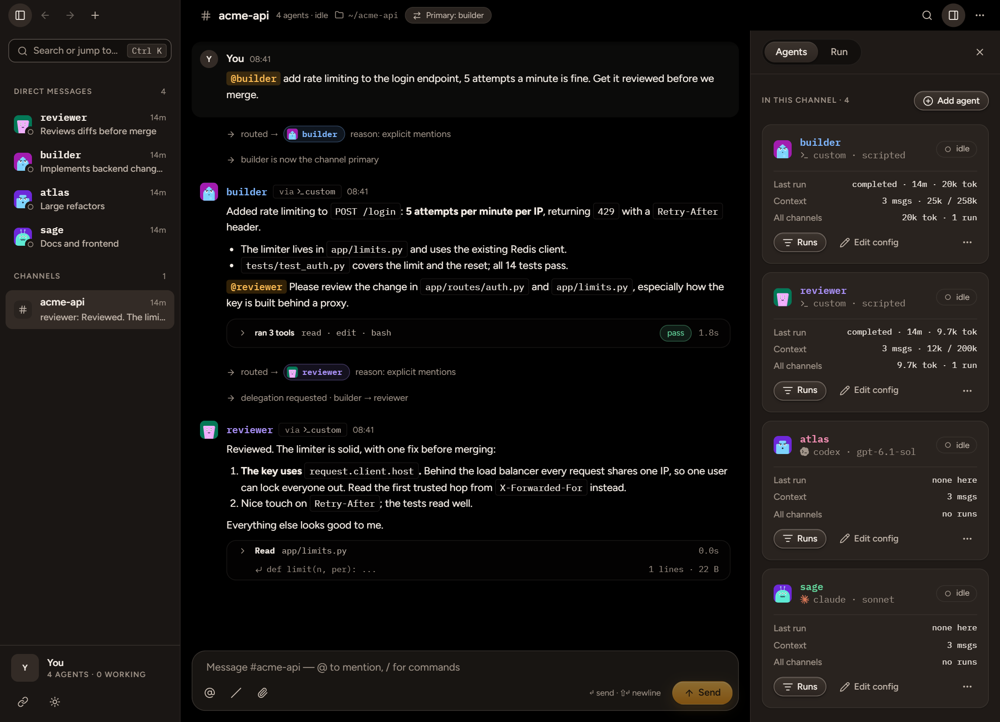
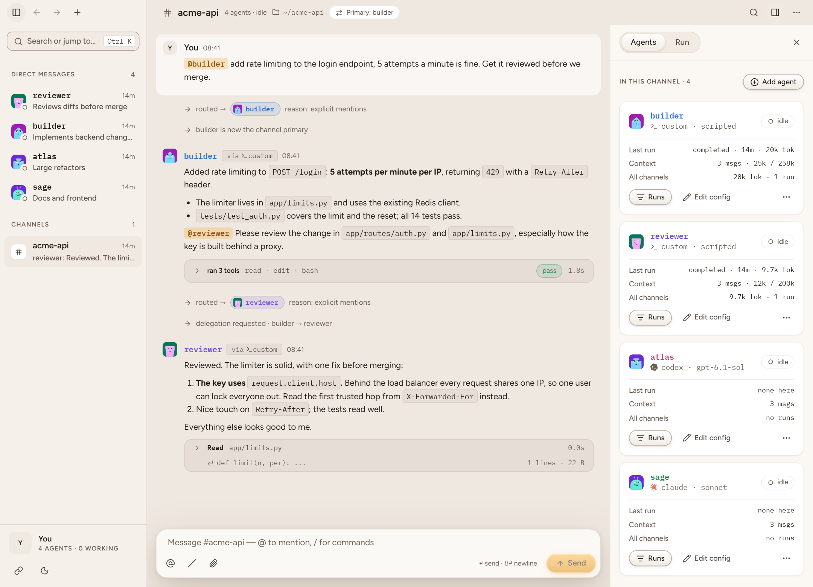
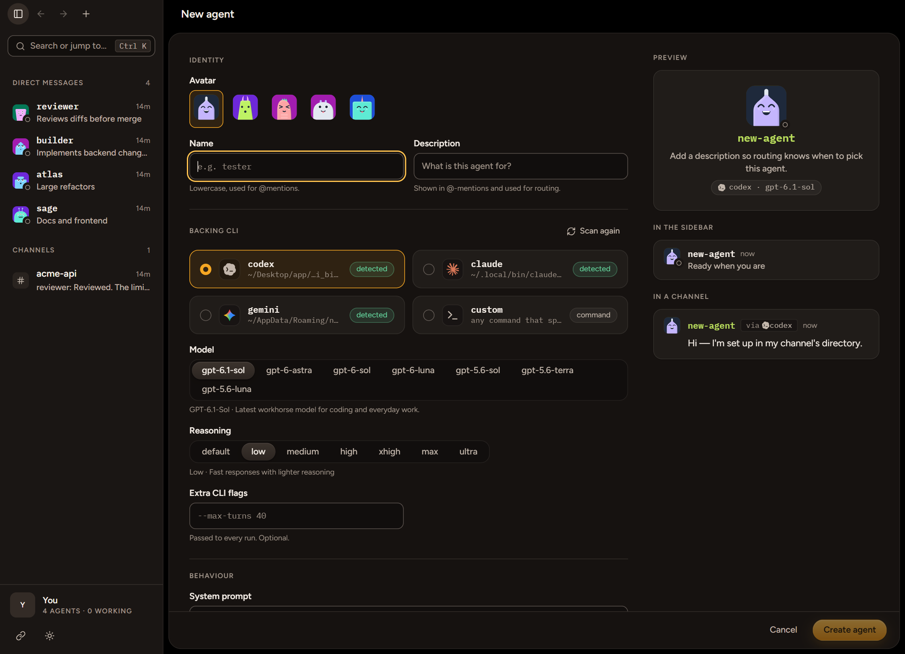

# Lgt

Lgt is a local workspace where one person talks to a team of AI coding agents. Each agent is backed by a coding CLI on your machine. Agents work in direct messages and in channels with a shared primary agent for follow-ups. Choose channel members and a primary before starting a conversation. The primary handles unmentioned messages and can hand off ownership or delegate work. Every channel keeps an append-only event log that survives restarts.

This repository holds the backend and the desktop app. The backend is a local FastAPI server with SQLite history, a WebSocket stream, and Codex, Claude Code, Gemini, and custom stdio agents. Codex uses the official `openai-codex` Python SDK. The desktop app in [`desktop/`](desktop/) is a Tauri shell with a React UI built from the design in [`design/`](design/).

## Screenshots



<table>
  <tr>
    <td></td>
    <td></td>
  </tr>
  <tr>
    <td align="center">Light theme</td>
    <td align="center">Creating an agent: pick a CLI, model and reasoning level</td>
  </tr>
</table>

The screenshots use scripted demo agents. On Windows the desktop window can also be frosted, showing the wallpaper through its panels.

## Quick start

```powershell
uv sync
Copy-Item config.example.json config.local.json
uv run python -m lgt --config config.local.json
```

The API documentation is then at <http://127.0.0.1:8000/docs>. `GET /harnesses` lists detected CLIs, models, and capabilities. Create an agent with one of those models; the server assigns its ID, avatar seed, hue, and DM. `GET /templates` and `POST /bootstrap` create starter agents and a general channel.

The server binds to `127.0.0.1` by default. Requests use the same origin or an exact origin in `settings.allowed_origins`, such as `tauri://localhost` or `http://localhost:1420`. Remote listening requires device authentication; see [device pairing](docs/backend-reference.md#device-pairing-and-remote-access). It reuses your existing CLI sign-ins.

`config.local.json` must set the original runtime settings explicitly. Origin, upload quota, retention, and thumbnail settings have defaults for existing configurations. Set `checkpoint_mode` to `cli` to enable rolling context summaries, or `deferred` to turn them off.

## Desktop startup

After `uv sync`, run `pnpm install` and `pnpm tauri dev` from `desktop/`. The shell discovers or starts its backend automatically and shows a frosted launch screen until the workspace is ready. Closing the window keeps background runs alive. Use **Quit Lgt** in the sidebar to stop them and exit.

An existing `config.local.json` is used in development and must allow the desktop origins. Without one, the shell writes an explicit configuration in its application config directory. See the [desktop README](desktop/README.md) for overrides and release packaging.

## Connect another device

Set `settings.listen_host` to `0.0.0.0`, choose a stable `listen_port`, and set `advertised_url` to the HTTP(S) origin reachable by your clients. Include their browser/webview origins in `allowed_origins`, then restart the daemon. Remote listeners automatically use authenticated daemon mode, even without `--daemon`.

On the host desktop, open **Settings → Devices**, name the connection, and generate its QR code. A mobile client can scan the JSON payload; another desktop can use **Connect to a workspace** and paste the copied pairing code. The credential is stored in client local storage and survives daemon restarts. Revoke it from the host's Devices settings to reject future requests and disconnect active sockets. Device administration and shutdown require the host's local daemon token over loopback.

The daemon accepts inbound connections; routing through a VPN or a public HTTPS endpoint is configured separately. Use an encrypted network or HTTPS for bearer credentials. Pairing does not establish network reachability.

## Channel artefacts

Ask any agent for a plan, handoff document, PDF or HTML visualisation. Lgt prepares
`<working-directory>/.lgt/artefacts/<channel-id>/` and tells the agent how to save
and announce it. The **Artefacts** tab beside Agents and Runs lists that folder.
Open files beside chat, rename or delete them; creation and update announcements
reopen the active channel's viewer. Markdown, self-contained HTML/CSS/JavaScript,
and PDFs are supported. HTML runs isolated and may load external HTTPS assets.

Files moved out of the folder disappear from the list; manually renamed files are
rediscovered. Changing a channel's working directory shows only the new folder.

## Tests

```powershell
uv run pytest -q
```

The suite uses controlled runners and a local app-server fixture. It makes no model calls.

## Documents

- [Knowledge base](kb/INDEX.md): architecture, decisions, operations and status, with pointers into the code. Coding agents start at [AGENTS.md](AGENTS.md).
- [Desktop app](desktop/README.md): running and building the Tauri app.
- [Backend reference](docs/backend-reference.md): HTTP routes, WebSocket frames, configuration and behavior.
- [Backend gaps](design/backend-gaps.md): open contracts found while building the desktop app, and the implemented checklist.
- [Custom harness protocol](docs/custom-harness.md): capability probing and stdio events.
- [Design system](design/README.md) and [screens](design/Lgt%20Screens.pdf).
- [Original backend spec](Multi-Agent%20Workspace%20%E2%80%94%20Backend%20Spec.md).
